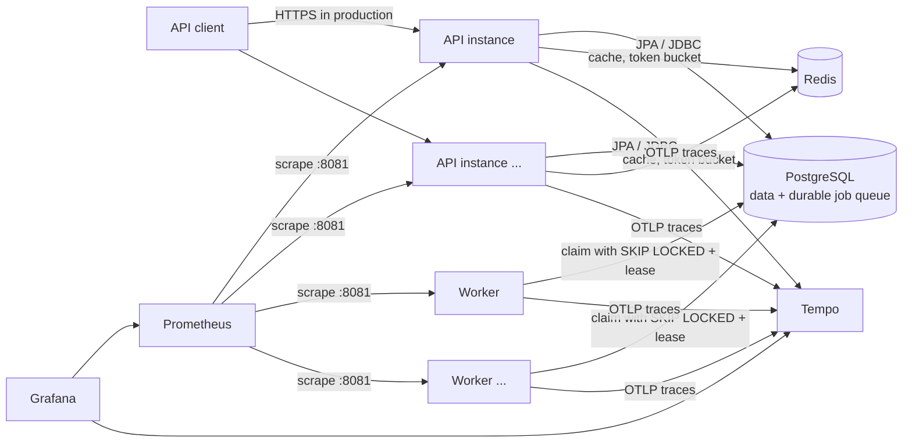

# CloudScale: Multi-Tenant API Platform

A Spring Boot platform for workspaces, projects and asynchronous processing jobs, built around the parts that are hard
to get right: tenant isolation, a durable PostgreSQL job queue with safe concurrent workers, Redis caching and a
distributed rate limiter, and graceful behavior when dependencies fail. Runs locally with one Docker Compose command,
with Prometheus, Grafana and Tempo (tracing) attached, plus a Helm chart and Terraform for Kubernetes/AWS.

Everything in this README was run and checked; the [Verified results](#verified-results) section lists the evidence and
[Not implemented](#not-implemented--not-verified) lists what was deliberately left out.

## Architecture



API and worker are the **same image** with different settings (`WORKER_ENABLED`). API instances are stateless: all
state is in PostgreSQL or Redis, so any number of replicas can run. Management endpoints (health, metrics) are on a
separate port (8081) that is not the public API port.

## Quick start

Prerequisites: Docker with Compose v2, about 4 GB of free memory for Docker.

```bash
docker compose up --build -d
```

| What | URL |
|---|---|
| API | http://localhost:8080/api/v1 |
| Swagger UI | http://localhost:8080/api/v1/docs |
| OpenAPI JSON | http://localhost:8080/api/v1/openapi |
| Health / metrics (management port) | http://localhost:8081/actuator/health/readiness, `/actuator/prometheus` |
| Prometheus | http://localhost:9090 |
| Tempo (traces; browse them in Grafana > Explore > Tempo) | http://localhost:3200 |
| Grafana (dashboard "CloudScale Overview") | http://localhost:3000, login `admin` / `admin-dev` (development only) |

Stop (add `-v` to delete all data):

```bash
docker compose down
```

### Try it

```bash
B=localhost:8080/api/v1; H='Content-Type: application/json'
TOKEN=$(curl -s -X POST $B/auth/register -H "$H" -d '{"email":"me@example.com","password":"correct-horse-battery"}' | python3 -c "import sys,json;print(json.load(sys.stdin)['accessToken'])")
AUTH="Authorization: Bearer $TOKEN"
WS=$(curl -s -X POST $B/workspaces -H "$H" -H "$AUTH" -d '{"name":"Acme"}' | python3 -c "import sys,json;print(json.load(sys.stdin)['id'])")
curl -s -X POST $B/workspaces/$WS/projects -H "$H" -H "$AUTH" -d '{"name":"Launch","description":"first project"}'
# a CSV analytics job; the Idempotency-Key makes retries safe
curl -s -X POST $B/workspaces/$WS/jobs -H "$H" -H "$AUTH" -H 'Idempotency-Key: demo-1' \
  -d '{"type":"CSV_ANALYTICS","payload":{"csv":"item,price\na,0.10\nb,0.20\nc,10.50\n","columns":["price"]}}'
curl -s $B/workspaces/$WS/jobs -H "$AUTH"
```

## API

Versioned under `/api/v1`; all endpoints except register/login/refresh/logout and the docs need `Authorization: Bearer <token>`.

| Area | Endpoints |
|---|---|
| Auth | `POST /auth/register`, `/auth/login`, `/auth/refresh`, `/auth/logout`; `GET /users/me` |
| Workspaces | `POST/GET /workspaces`, `GET/PATCH/DELETE /workspaces/{id}` |
| Members | `GET/POST /workspaces/{id}/members`, `PATCH/DELETE /workspaces/{id}/members/{userId}` |
| Projects | `POST/GET /workspaces/{id}/projects`, `GET/PATCH/DELETE .../projects/{projectId}` (pagination, `status` filter, whitelisted `sort`) |
| Jobs | `POST/GET /workspaces/{id}/jobs`, `GET .../jobs/{jobId}`, `POST .../jobs/{jobId}/cancel`, `GET .../jobs/{jobId}/download` |
| Ops | `GET /actuator/health/liveness`, `/actuator/health/readiness`, `/actuator/prometheus` (port 8081) |

Errors always use one schema: `{timestamp, status, error, message, path, details[]}`.

## Design

### Authentication
Passwords are hashed with BCrypt. Access tokens are short-lived (15 min) signed JWTs (Nimbus via Spring Security, no
custom crypto). Refresh tokens are random 256-bit values stored **only as SHA-256 hashes** and **rotated on every use**.
Presenting an already-used refresh token is treated as theft: the whole token family is revoked (tested: the legitimate
newer token stops working too). Logout revokes server-side. The signing secret must be supplied (`JWT_SECRET`, at least
32 bytes); the app refuses to start without it.

### Multi-tenancy and authorization
Every tenant-owned query is scoped by workspace id (`findByIdAndWorkspaceId`, workspace-scoped job and export queries),
and every service method first calls a single authorization gate that reads the caller's membership **from PostgreSQL**
(never from cache). A non-member gets **404, not 403**, so ids cannot be probed across tenants. Roles: `OWNER > ADMIN >
MEMBER`. Escalation rules (all tested): only the owner can grant ADMIN or change roles; no one can grant OWNER or
demote/remove the owner; ADMINs cannot create other admins.

### Job engine (PostgreSQL queue)
Workers claim jobs with `UPDATE ... WHERE id IN (SELECT ... FOR UPDATE SKIP LOCKED)`, so concurrent workers lock disjoint
rows. A claim sets a **lease**; long jobs renew it with a heartbeat. If a worker dies, the lease expires and another worker
reclaims the job. `attempt_count` is a **fencing token**: results are written only if `status = RUNNING AND attempt_count =
mine`, so a zombie worker cannot overwrite the new owner's result. Transient failures retry with exponential backoff
(2s, 4s, ... capped at 5 min) up to 3 attempts; malformed input fails immediately without retries. A bounded thread pool
and "claim only free slots" keep memory bounded. `Idempotency-Key` makes duplicate submissions collapse onto one job
(unique partial index), including concurrent ones.

**Delivery guarantee: at-least-once.** A crash or lease expiry can run a job twice. Job types are written to be safe to
repeat (the CSV job is pure; the export only reads), but exactly-once is not claimed.

Job types: `CSV_ANALYTICS` (count/sum/mean/min/max of numeric columns, exact `BigDecimal` math, 1 MB / 100k row / 10
column limits) and `PROJECT_EXPORT` (JSON export of one project, stored as the job result and served by an authenticated
download endpoint).

### Redis
- **Cache:** workspace summary and project metadata, keys `cs:v1:ws:{workspaceId}:...` (tenant-scoped), TTL 60 s,
  evicted **after commit** on writes. Authorization is never cached. Hit/miss/error counters are exported.
- **Rate limiting:** token bucket in a Lua script (atomic, uses Redis server time), shared by all instances. Auth
  endpoints: 10 requests/minute per client IP. Everything else: per user (per IP when unauthenticated). 429 with `Retry-After`.
- **Redis down:** reads fall back to PostgreSQL; a small circuit breaker skips Redis for 5 s after a failure so an
  outage costs one timeout, not one per request. API traffic **fails open** (not limited); auth endpoints fall back to a
  per-instance limit so credential stuffing is still throttled, just less precisely. Staleness is bounded by the TTL.
- Forwarded headers (`X-Forwarded-For`) are ignored unless `trust-forward-headers` is enabled; enable it only behind a trusted proxy.

### Observability
Micrometer metrics scraped by Prometheus (request rate, latency histograms, 5xx, cache hit/miss/error, rate-limited
requests, job outcomes and durations, active jobs, HikariCP, JVM heap, CPU). One provisioned Grafana dashboard with
API, jobs and JVM/infrastructure sections. Logs are structured JSON with a request id (`X-Request-Id`, echoed on the
response); request bodies and tokens are never logged.

**Distributed tracing (OpenTelemetry to Tempo):** every request is traced. The trace context of the request that submits a
job is stored on the job row, so the worker's `job.process` span becomes a child of that request's span even though it runs
later on another process. Log lines carry `traceId`/`spanId`. Sampling defaults to 100% locally (`TRACING_SAMPLING`; the Helm
chart defaults to 10%).

## Verified results

Environment: Apple M3 Pro, 18 GB RAM; containers run in a 4-CPU / 8.7 GB Colima VM (k6 and all services share it).

**Tests: 26 passing.** 8 unit tests and 18 integration tests, run against real PostgreSQL 16 and Redis 7 (see
[Running the tests](#running-the-tests)). They cover: the full register to job to result to audit flow; cross-tenant access
attempts on every endpoint; role escalation rules; refresh rotation, reuse detection and logout; idempotency keys (including
8 concurrent submissions producing exactly one job); 80 jobs claimed by 8 concurrent workers with no job claimed twice;
lease expiry reclaim and zombie-worker fencing; retry/backoff, give-up and permanent failure; cancellation of a running
job; concurrent workspace updates (exactly one winner of 8); duplicate concurrent member adds; cache invalidation and
cross-tenant isolation; **rate limiting shared across two separate application instances** (exactly `capacity` requests allowed).

Two real bugs were found and fixed by these tests/runs: refresh-token reuse detection was being rolled back with its own
401 (fixed with `noRollbackFor`), and a database outage returned 500 instead of 503 (now 503 + `Retry-After`).

**Failure tests on the running stack:**

| Scenario | Observed |
|---|---|
| Both workers `kill -9`'d mid-job, then restarted | Job stayed RUNNING until its lease expired, then was reclaimed: `SUCCEEDED`, `attempt=2`, correct result |
| Redis stopped | API kept serving (200/201) from PostgreSQL; first request paid ~0.5 s, then ~20 ms; readiness stayed 200; cache resumed hitting after Redis returned |
| PostgreSQL stopped | API returned 503 + `Retry-After`; liveness 200, readiness 503; workers survived; fully recovered about 2 s after PostgreSQL returned |
| Invalid token / cross-tenant / rate-limit exhaustion / malformed or oversized job | Covered by the integration tests above |

**Prometheus and Grafana:** Prometheus scraped the API and both workers; the Grafana dashboard is provisioned and loads
(checked through the Grafana API). Metrics shown come from the services, not from fixtures.

**Distributed tracing:** submitted a job through the API and queried Tempo. One trace contained 7 spans, including
`http post /api/v1/workspaces/{id}/jobs` and the worker's `job.process` span, with `job.process` parented to the request's span
and tagged with `job.id`, `job.type` and `job.attempt`.

**Kubernetes (kind) and Helm:** `helm lint` passes, manifests pass a server-side dry run, the chart deploys and processes jobs,
the HPA read real metrics and **scaled the API 2 -> 4 -> 6 replicas under load**, and a rolling update, a rollback and a deleted
API pod under continuous traffic produced **4,038 of 4,038 expected responses (no errors)**. Details, commands and the problems
found (service-link env vars, Helm/kubectl field conflicts) are in [docs/kubernetes.md](docs/kubernetes.md).
Scale-down, ingress and node drains were not tested.

**Terraform (AWS):** `terraform fmt -check -recursive`, `terraform init -backend=false` and `terraform validate` pass.
`apply` was never run; **no AWS resources were created and the deployment is unverified**. See [docs/terraform.md](docs/terraform.md)
for the design, state handling and approximate cost (roughly US$180-220/month if left running).

**Load tests (k6, 30 s each, 0% errors in every run).** Mixed workload: reads, project/job creation, and logins; one shared user.

| Run | Users | Req/s | p50 | p95 | p99 |
|---|---|---|---|---|---|
| Light, cache on (2% logins) | 10 | 1,441 | 2.6 ms | 10.3 ms | 168 ms |
| Light, cache off (2% logins) | 10 | 1,323 | 3.0 ms | 11.0 ms | 176 ms |
| Moderate, cache on (2% logins) | 50 | 1,261 | 22 ms | 75 ms | 640 ms |
| Stress, cache on (2% logins) | 200 | 1,239 | 108 ms | 481 ms | 973 ms |
| Light, cache on, **no logins** | 10 | 2,945 | 2.9 ms | 6.3 ms | 9.9 ms |
| Light, cache off, **no logins** | 10 | 2,542 | 3.4 ms | 6.9 ms | 10.9 ms |

What the numbers show (and do not):
- **Bottleneck is API CPU, not the database.** The API container ran at about 320% CPU of the VM's 4 cores while PostgreSQL sat near 25%. Throughput plateaus at roughly 1,250-1,450 req/s; extra users only add queueing latency.
- **BCrypt logins dominate the tail.** Removing the 2% logins doubled throughput and cut p99 from 168 ms to 10 ms. (This is intentional cost: adaptive hashing should be slow.)
- **The cache helps modestly here:** about 16% more throughput and 15% lower p50 without logins, because the underlying reads are primary-key lookups that PostgreSQL already serves quickly. It would matter more with heavier queries.
- These are test configurations on one laptop-class VM, not production capacity claims. The first four runs used a slightly different create/submit split (4%/4%) than the last two (5%/5%).

Raw results are in [docs/benchmarks](docs/benchmarks); reproduce with `scripts/benchmark.sh <label> <vus> <duration> <cache true|false>`
(set `LOGIN_RATE=0` to drop logins).

## Running the tests

Unit tests need nothing. Integration tests need PostgreSQL and Redis from Compose; they use a **separate database**
(`cloudscale_test`, created automatically on first start) so the Compose workers never claim test jobs.

```bash
export JAVA_HOME=$(/usr/libexec/java_home -v 21)
docker compose up -d postgres redis
(cd backend && mvn -B verify)      # 8 unit + 18 integration tests
```

If your Postgres volume predates the test database, create it once:
`docker compose exec postgres psql -U cloudscale -d cloudscale -c "CREATE DATABASE cloudscale_test"`.

## Security considerations

Implemented and tested: BCrypt password hashing; short-lived JWTs; refresh rotation with reuse detection and server-side
revocation; tenant isolation and 404-on-foreign-id; role escalation rules; rate limiting (including auth endpoints);
bean validation, whitelisted sort fields and bounded page sizes; parameterized queries only (JPA bind parameters and
JdbcTemplate placeholders); CSV/job size limits; management endpoints on a separate port; JSON errors without internals;
non-root container; no secrets in the repository (`JWT_SECRET` has no default in the application).

**Development-only defaults** (replace for any public deployment): Compose supplies a dev JWT secret, database password and
Grafana password; ports are bound to localhost; TLS is not terminated here (needs an ingress/load balancer); registration
is open. Known gaps: no account lockout, email verification, password reset or MFA; register/add-member responses reveal
whether an email exists (a deliberate usability trade-off, mitigated by rate limits); no dependency vulnerability scanning.

## Trade-offs

- **PostgreSQL as the queue** (no Kafka/RabbitMQ): one fewer system, transactional enqueue with business data, easy
  idempotency. The cost is polling and database load; it suits thousands of jobs per minute, not millions per second.
- **Fail-open API rate limiting** when Redis is down: availability over strict limiting. See [ADR 0002](docs/decisions/0002-redis-cache-and-rate-limiting.md).
- **One image, two roles** for API and worker: simple deployment; they scale independently by replica count.
- Authorization reads membership from PostgreSQL on every request: a little slower, but a removed member loses access immediately.

Decision records: [0001 PostgreSQL](docs/decisions/0001-postgresql.md), [0002 Redis](docs/decisions/0002-redis-cache-and-rate-limiting.md),
[0003 Postgres job queue vs broker](docs/decisions/0003-postgres-job-queue.md).

## Not implemented / not verified

Nothing below is claimed:

- **A real AWS deployment**: Terraform is validated only; it has never been planned against an account or applied. Redis TLS (`REDIS_SSL`) was not tested against ElastiCache.
- Kubernetes gaps: HPA scale-down, Ingress behavior (no controller installed), NetworkPolicies, node drains, and worker-crash recovery on Kubernetes (that was tested on Compose).
- Static analysis, formatting checks and dependency vulnerability scanning are not set up.
- Integration tests use the Compose PostgreSQL/Redis, not Testcontainers.
- The GitHub Actions workflow (`.github/workflows/ci.yml`) has **not been run**.
- Grafana has one dashboard with three sections rather than three dashboards; no screenshots; no Postman collection (use the curl examples and Swagger UI).

## Repository layout

```
backend/                Spring Boot app (API + worker), Dockerfile, tests
infrastructure/         helm chart, kubernetes manifests, terraform (AWS), prometheus, grafana, tempo, postgres init
tests/performance/      k6 load test
scripts/benchmark.sh    reproducible benchmark runner
docs/kubernetes.md     Helm/kind deployment and verification
docs/terraform.md      AWS design, state, cost
docs/decisions/         architecture decision records
docs/benchmarks/        measured results (JSON)
docker-compose.yml      full local stack
```
